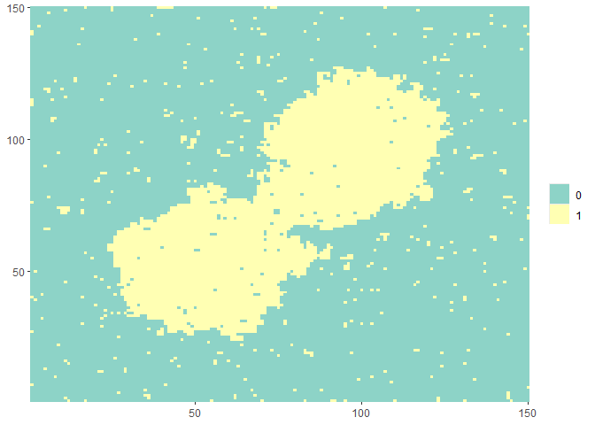
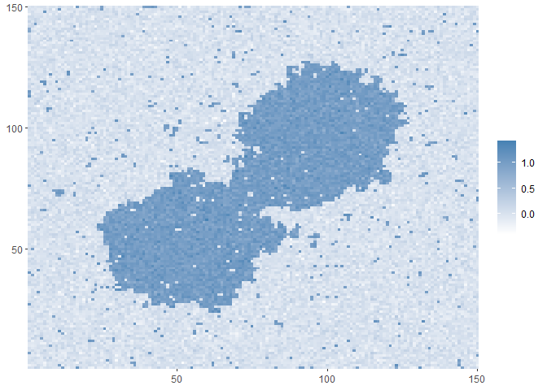
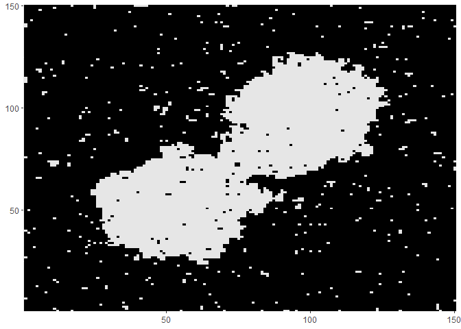
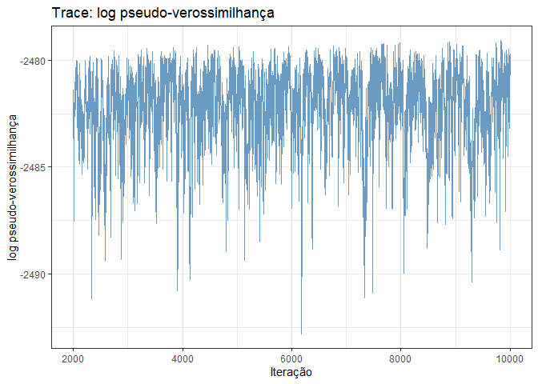
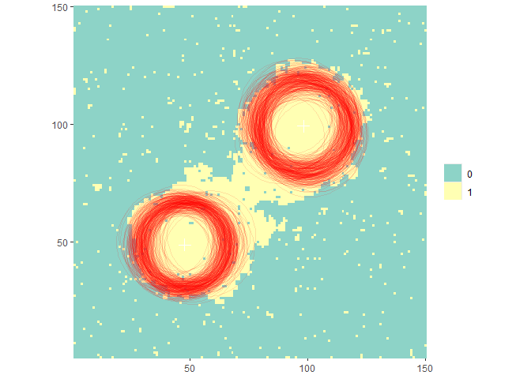
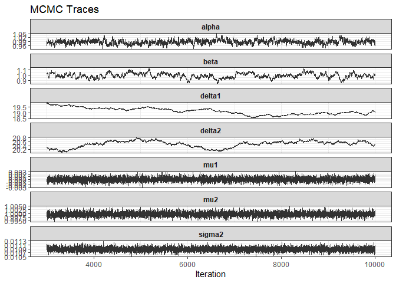
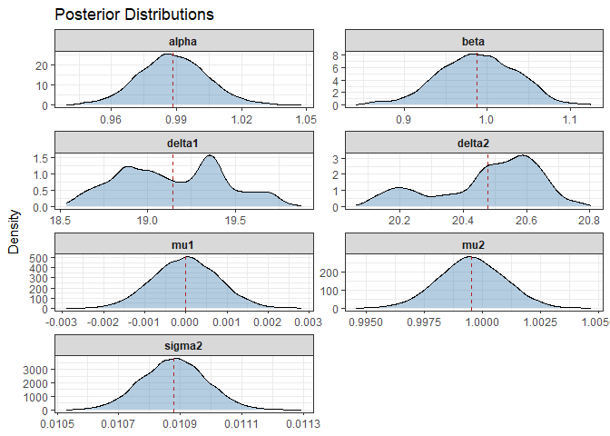
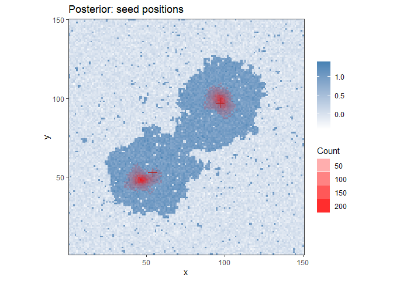

<!-- README.md is generated from README.Rmd. Please edit that file -->

# mrfseeds

Image generation and bayesian parameter inference package for MRFs with
centrality effects

## Features

- Generate synthetic images using MRF models
- Bayesian parameter inference with Metropolis-within-Gibbs
- Seeds visualization

## Installation

``` r
# Install from GitHub
devtools::install_github("wescabral/mrfseeds")
```

## Example

``` r
library(mrfseeds)
set.seed(1)

# Generate a random image
real_seeds <- list(
  list(position = c(50, 50),   color = 1, delta = 20),
  list(position = c(100, 100), color = 1, delta = 20)
)
mod <- seedModel$new(alpha = 1, beta = 1, seeds = real_seeds, ncolors = 2)
img <- mod$sampleImage(dim = c(150, 150), steps = 80)
img$plot()
```



#### Noisy image

``` r
Y <- img$matrix + rnorm(prod(dim(img$matrix)), sd = 0.1)
img$setMatrix(Y, continuous = TRUE)
img$plot()
```



#### Infer parameters

``` r
priors <- list(
  shape_alpha = 2, rate_alpha = 1, 
  shape_beta  = 10, rate_beta  = 0.5,
  shape_delta = 5, rate_delta = 0.5,
  m = 0, tau = 0.001,
  a = 10, b = 10
)
seeds_info <- list(list(color = 1, n_seeds = 2))
sampler <- seedBayesianCont$new(image = img, seeds_info = seeds_info, ncolors = 2, priors = priors)
sampler$plotZ()   # First look at the cleansed image
```



``` r
# init = NULL would initialize over PL inference
res <- sampler$run(n_iter = 10000, step_size = 0.01, init = list(alpha = 1, beta = 2, deltas = c(20, 20, 20)))
```

``` r
# Generate results
res$plot_logpl_trace()          # Convergence analysis
```



``` r
res$plot_image(n_samples = 300, burn_in = 3000) # Circles for influence area estimates
```



``` r
res$plot_traces(burn_in = 3000)
```



``` r
res$plot_densities(burn_in = 3000)
```



``` r
print(res, burn_in = 3000)
#> <seedBayesianResult>
#>   chain               : 10000 iterations  (summarising from 3001)
#>   acceptance (params) : 75.4%
#>   acceptance (pos)    : 92.0%
#>   posterior (mean  [95% CI]):
#>     alpha       0.9883  [0.9575, 1.0203]
#>     beta        0.9879  [0.8924, 1.0735]
#>     delta1      19.1458  [18.6300, 19.7159]
#>     delta2      20.4783  [20.1295, 20.7138]
#>     mu1         -0.0000  [-0.0016, 0.0015]
#>     mu2         0.9995  [0.9967, 1.0024]
#>     sigma2      0.0109  [0.0107, 0.0111]
res$posterior_mean(burn_in = 3000)
#>         alpha          beta        delta1        delta2           mu1 
#>  9.883309e-01  9.879000e-01  1.914581e+01  2.047827e+01 -4.286304e-06 
#>           mu2        sigma2 
#>  9.995444e-01  1.087958e-02
res$credible_interval(level = 0.95, burn_in = 3000)
#>    param        lower        upper
#> 1  alpha  0.957541791  1.020291938
#> 2   beta  0.892356763  1.073511818
#> 3 delta1 18.629957792 19.715923235
#> 4 delta2 20.129503216 20.713770024
#> 5    mu1 -0.001552544  0.001547266
#> 6    mu2  0.996704696  1.002361292
#> 7 sigma2  0.010677104  0.011083749
res$plot_positions()
```


